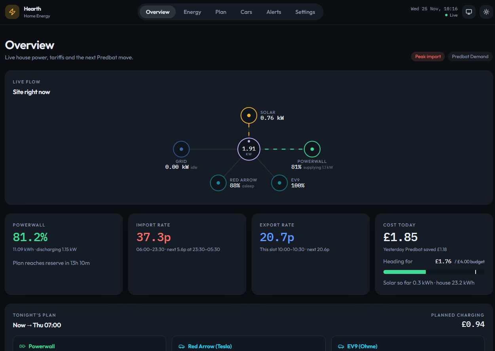
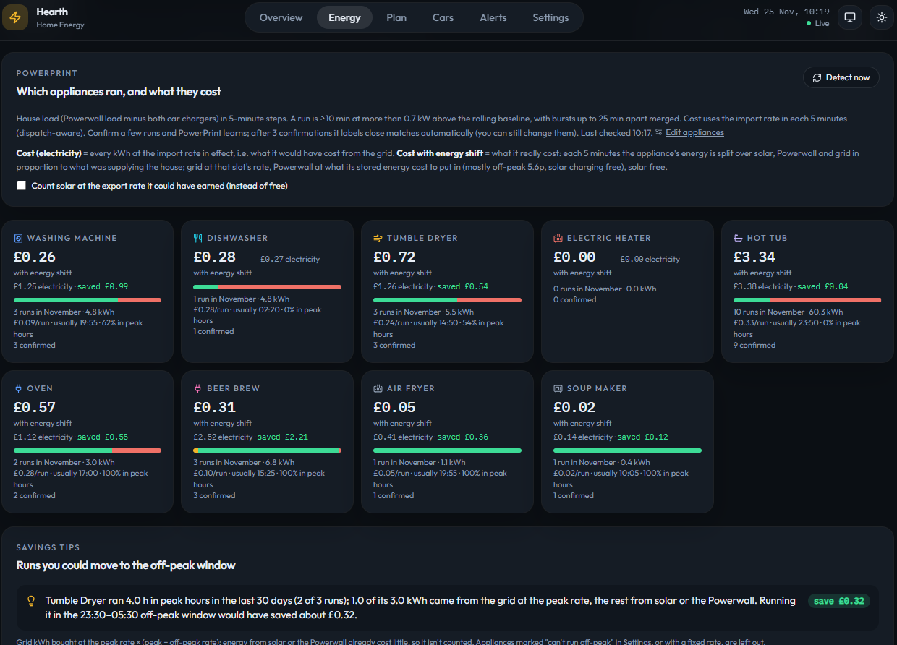

# Hearth

A self-hosted home energy dashboard for [Home Assistant](https://www.home-assistant.io/), [Predbat](https://github.com/springfall2008/batpred), and UK energy tariffs (especially Octopus). It is a live view of your battery, solar, grid, cars and overnight plan — plus costs, PowerPrint appliance runs, and alerts.

Hearth does **not** replace Predbat or Home Assistant. It reads (and, if you allow it, sends a small set of) entities that you map in **Settings → Variables**. Your Home Assistant long-lived token never leaves the server and is never sent to the browser.

 

## Features

- Live power flow (solar, battery, grid, home, cars) with last-known values when a car integration drops out
- Tonight's Predbat plan, a 30-minute plan timeline, and Powerwall charge / export windows
- Cars: planned vs actual overnight charging, Intelligent Octopus Go dispatches, charger power history
- Financials and a "what if I had no solar or battery" counterfactual, using official Octopus statistics where you map them
- Octopus reconciliation (Energy tab): official daily import/export kWh versus Powerwall, with the same style of date-range picker as Financials, optional meter fill for missing official days, and CSV export
- PowerPrint: detects appliance-sized runs, splits energy into solar / battery / grid, and compares grid cost with the shifted cost
- Alerts (in-app, Web Push, optional Telegram) for a missed planned charge, a cheap IOG slot, a low battery, an export-rate spike, lost car data, and a daily cost budget
- **Settings → Variables** — map your own Home Assistant entities in four groups (Home Energy, Vehicles, Energy Tariff, Predbat). Add or remove cars, link a charger to a car or keep it standalone. Changes apply immediately, with no rebuild. Values are stored in `variables.json` next to your other settings.

## Requirements

- Docker (recommended) or Node.js 22+
- A reachable Home Assistant instance and a **long-lived access token**
- Useful, but not all required: a Tesla Powerwall (or similar battery), Predbat, the official Octopus Energy integration, Solcast (via Predbat's PV forecast), and one or more EVs / wall chargers

You can start with a partial mapping. Missing sensors show as "—" or zero; see [docs/SETUP.md](docs/SETUP.md) for first-run behaviour and known gaps.

## Quick start

```bash
git clone https://github.com/jamesdonovan/hearth-energy.git
cd hearth-energy
cp .env.example .env
# Edit .env: set HA_URL and HA_TOKEN. Do not commit .env.
cp docker-compose.example.yml docker-compose.yml   # already present as docker-compose.yml
docker compose up -d --build
```

Open http://localhost:3000, go to **Settings → Variables**, and map your entities. Recommended names for Tesla Powerwall, Tesla Fleet, Kia UVO, Ohme, Octopus Energy, Solcast and Predbat are listed in [docs/INTEGRATIONS.md](docs/INTEGRATIONS.md).

Full walkthrough, reverse-proxy notes, and a development install: [docs/SETUP.md](docs/SETUP.md). For later updates (`docker pull` of the published image, or `git pull` and a rebuild), see [docs/UPDATES.md](docs/UPDATES.md).

## Configuration

| Variable | Default | Purpose |
| --- | --- | --- |
| `HA_URL` | — | Home Assistant base URL, e.g. `http://homeassistant.local:8123` or `http://homeassistant:8123` on the same Docker network |
| `HA_TOKEN` | — | Long-lived access token (env only; never stored in `variables.json`) |
| `PORT` / `HOST` | `3000` / `0.0.0.0` | Bind address |
| `TZ` | `Europe/London` | Timezone for cheap-rate windows and daily totals |
| `ALLOW_ACTIONS` | `true` | Set `false` to reject all control POSTs |
| `DATA_DIR` | `/app/data` in Docker | Settings, variables, audit log, VAPID keys, alerts |
| `PUBLIC_URL` | unset | Public URL for Telegram deep links, e.g. `https://hearth.example.com` |
| `TELEGRAM_BOT_TOKEN` / `TELEGRAM_CHAT_ID` | unset | Optional seed; prefer Settings → Telegram (token is write-only on the server) |

Fallback unit rates, the off-peak window, battery capacity and PowerPrint thresholds are edited in **Settings → Variables**, not in `.env`.

## Security

- Keep Hearth off the public internet, or put it behind a reverse proxy that requires authentication.
- The HA token and Telegram bot token stay on the server. Location `device_tracker` entities are forwarded as `home` / `not_home` only — coordinates are stripped.
- Control actions (charge switches, Predbat mode, a boost helper, a charger mode) are limited to roles you have configured. Use `ALLOW_ACTIONS=false` for a read-only deployment.
- Do not commit `.env`, `data/`, or a real `variables.json` that contains your MPAN, meter serials or vehicle names if you want to keep those private.

## Licence

Hearth is licensed under the [PolyForm Noncommercial License 1.0.0](https://polyformproject.org/licenses/noncommercial/1.0.0). See [LICENSE](LICENSE).

It is free to use for personal and other noncommercial purposes. Commercial use (including selling the software, offering it as a paid service, or using it in a commercial product) needs permission from the author. The author can grant a separate commercial licence later.

Required Notice: Copyright (c) 2026 James Donovan

## Contributing

See [CONTRIBUTING.md](CONTRIBUTING.md).
